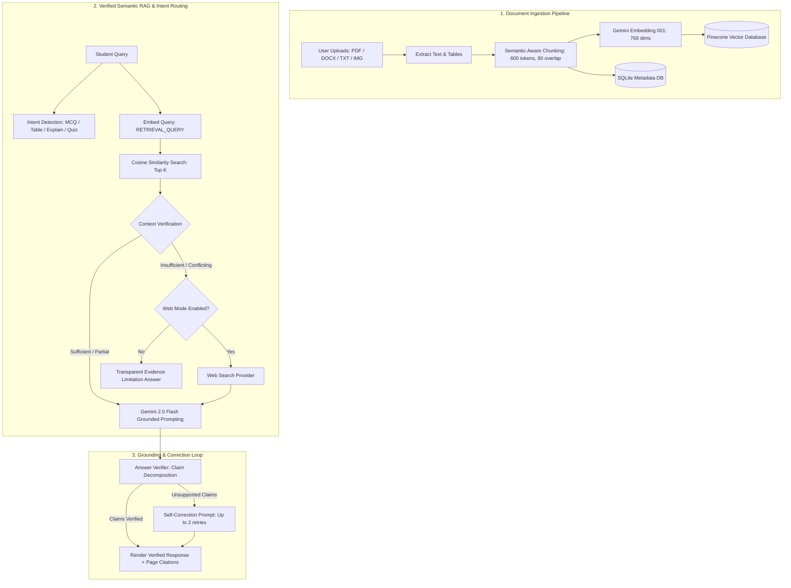

# AI-Powered Multimodal Study Assistant Using RAG and LLMs
**B.Tech CSE Major Project — Phase I Implementation**

---

## 📌 Executive Overview
The **AI-Powered Multimodal Study Assistant** is a full-stack, enterprise-grade academic learning companion. Unlike standard chatbots that hallucinate or provide unverified answers, this system implements a multi-stage **Retrieval-Augmented Generation (RAG)** pipeline featuring:
1. **Multimodal Ingestion**: Support for PDFs, Word DOCX files, plain text, and scanned lecture slides/diagrams (OCR).
2. **Deterministic Context Verification**: Pre-generation assessment of retrieved passage relevance, sufficiency, and version contradictions.
3. **Claim Grounding & Automated Correction**: Real-time extraction of atomic factual claims from generated answers, matching against source passages with an automated self-correction loop.
4. **Transparent Provenance & Web Fallback**: Clear demarcation between document-grounded facts and external search facts (Google Custom Search), preventing ungrounded speculation.
5. **Interactive Academic Study Workbench**: Adaptive intent recognition generating interactive MCQs, 3D flip flashcards, formula sheets, structured comparison tables, and summaries.

---

## 🏗️ Architecture Pipeline



---

## 🛠️ Technology Stack

| Layer | Technologies Used |
|---|---|
| **Backend Framework** | FastAPI (Python 3.12, Uvicorn, ASGI) |
| **LLM & Embeddings** | Google Gemini (`gemini-2.0-flash`, `gemini-embedding-001`) via official `google-genai` SDK |
| **Vector Store** | Pinecone (`ServerlessSpec`, 768 dimensions, cosine similarity) |
| **Local Database** | SQLite via SQLAlchemy 2.0 Async + `aiosqlite` |
| **Document Processing** | `PyMuPDF` (fitz), `python-docx`, `Pillow`, `pytesseract` |
| **Frontend UI/UX** | React 19, TypeScript, Vite, Modern Glassmorphism CSS, Lucide Icons |
| **Testing** | `pytest`, `pytest-asyncio`, `pytest-httpx` |

---

## 🚀 Quickstart & Setup Guide

### 1. Prerequisites
- Python 3.10+ (tested on Python 3.12)
- Node.js 18+ (tested on Node.js 22)
- Pinecone API Key
- Google Gemini API Key

### 2. Environment Setup
The project root contains `.env`:
```env
GEMINI_API_KEY=your_gemini_key_here
GEMINI_EMBEDDING_MODEL=gemini-embedding-001
GEMINI_GENERATION_MODEL=gemini-2.0-flash
EMBEDDING_DIMENSION=768

PINECONE_API_KEY=your_pinecone_key_here
PINECONE_INDEX_NAME=study-assistant
PINECONE_NAMESPACE=default

MAX_UPLOAD_SIZE_MB=25
CHUNK_SIZE_TOKENS=600
CHUNK_OVERLAP_TOKENS=80
RETRIEVAL_TOP_K=10
FINAL_CONTEXT_TOP_K=5
SIMILARITY_THRESHOLD=0.5
```

### 3. Running the Backend Server
```bash
# Navigate to backend directory
cd backend

# Install dependencies (already installed)
pip install -r requirements.txt

# Run FastAPI backend with Uvicorn
python -m uvicorn app.main:app --reload --host 127.0.0.1 --port 8000
```
- Interactive Swagger API Docs: `http://127.0.0.1:8000/docs`
- Health Check: `http://127.0.0.1:8000/health`
- Live Diagnostics: `http://127.0.0.1:8000/api/status`

### 4. Running the Frontend Application
```bash
# In a separate terminal, navigate to frontend directory
cd frontend

# Run Vite dev server
npm run dev
```
Open `http://localhost:5173` in your browser.

---

## 🧪 Running Automated Test Suite
From the `backend` directory:
```bash
python -m pytest -v
```
**Test Coverage Includes:**
- Root & System status endpoints
- Document upload validation (MIME-type check, extension whitelist)
- Chunking boundary tests & page tracking
- Intent detection pattern matching (MCQs, quizzes, tables, summaries, flashcards)

---

## 💡 Key Features Implemented

1. **Document Ingestion Hub (`/api/documents`)**:
   - Single & batch uploads with live background processing state (`UPLOADED` → `EXTRACTING` → `CHUNKING` → `EMBEDDING` → `INDEXING` → `READY`).
   - Chunk inspection modal: view exact token counts, source page ranges, and section headings.
   - Selective filtering: check or uncheck individual documents to narrow Q&A context.

2. **Study Q&A Chat (`/api/chat`)**:
   - Toggle between **Document Only** (strict academic grounding) and **Documents + Web Fallback**.
   - Optional external fact-checking toggle.
   - Real-time verification shield with confidence percentage.
   - Clickable citations showing document name, page number, similarity score, and excerpt.

3. **Adaptive Output Formats**:
   - **Interactive MCQ Quizzes**: Choose options directly in the chat UI with immediate green/red feedback and detailed answer explanations.
   - **3D Flip Flashcards**: Interactive memory cards for formulas and definitions.
   - **Comparison Tables**: High-density markdown tables.

4. **Study Workbench (`/api/study`)**:
   - **Summarize**: Brief, standard, or deep section summaries.
   - **Concept Deep-Dive**: Simple (ELI5), standard, or advanced level explanations with code and worked examples.
   - **Revision Notes**: High-yield exam notes and formula cheat-sheets.
   - **Practice Questions**: Custom question count (5-25) with customizable difficulty.

5. **System Health & Diagnostic Dashboard (`/api/status`)**:
   - Real-time Pinecone vector count, active SQLite documents, and embedding dimensionality metrics.
